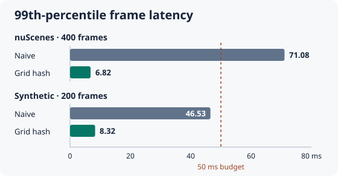

# lidar-latency

A C++17 lidar perception pipeline that replays nuScenes lidar sweeps at 20 Hz, measures the latency of each stage, and then optimizes the slowest stage.

Pipeline: voxel downsample, ground removal, Euclidean clustering.

Goal: cut p99 frame latency at least 2x and count frames over a 50 ms budget, before and after optimization.

## Benchmark results



Grid hashing cut nuScenes p99 latency by **10.4×**. Frames over the 50 ms budget went from **93 of 400 to 0 of 400**. See [LOG.md](LOG.md) for the full benchmark and optimization history.

## Build and run

```sh
cmake -S . -B build -DCMAKE_BUILD_TYPE=Release
cmake --build build -j
ctest --test-dir build
./build/lidar_replay --synthetic 200 --out results/baseline_synthetic.csv
./build/lidar_bench
```

Add `--naive-cluster` to replay with the O(n²) baseline search.

Real data: see [scripts/get_data.md](scripts/get_data.md), then `./build/lidar_replay --data data/sweeps/LIDAR_TOP`.
