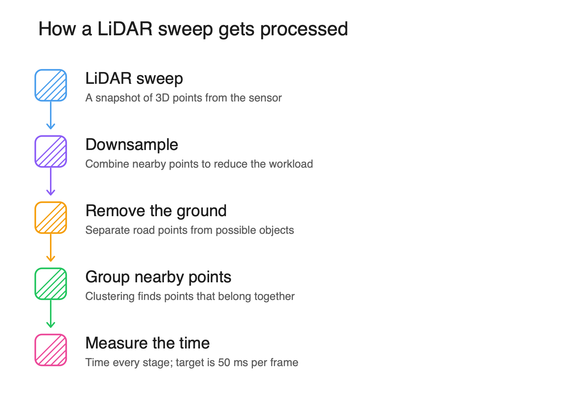

# lidar-latency

A C++17 LiDAR pipeline for measuring and reducing point-cloud processing latency. It times each stage against a 50 ms frame budget and compares a naive clustering search with a grid-hash search.

## Pipeline

Each LiDAR sweep moves through five steps: replay, voxel downsampling, ground removal, Euclidean clustering, and timing. The diagram explains what each step does before comparing the clustering searches.



## Results

Grid hashing reduced nuScenes p99 frame latency from **71.08 ms to 6.82 ms (10.4×)**. Frames above the **50 ms** budget fell from **93 of 400 to 0 of 400**.

| Dataset | Naive p99 | Grid-hash p99 | Frame budget |
| --- | ---: | ---: | ---: |
| nuScenes | 71.08 ms | 6.82 ms | 50 ms |
| Synthetic | 46.53 ms | 8.32 ms | 50 ms |

See [LOG.md](LOG.md) for the benchmark and optimization history.

## Build and run

```sh
cmake -S . -B build -DCMAKE_BUILD_TYPE=Release
cmake --build build -j
ctest --test-dir build
out=$(mktemp -d)
./build/lidar_replay --synthetic 200 --out "$out/synthetic.csv"
./build/lidar_bench
```

Add `--naive-cluster` to replay with the O(n²) baseline search, or `--realtime` to pace replay at 20 Hz. By default, replay runs as fast as possible.

For real data, follow [scripts/get_data.md](scripts/get_data.md), then run:

```sh
out=$(mktemp -d)
./build/lidar_replay --data data/sweeps/LIDAR_TOP --out "$out/nuscenes.csv"
```

See [Reproduce the comparison](LOG.md#reproduce-the-comparison) for the paired benchmark commands.
